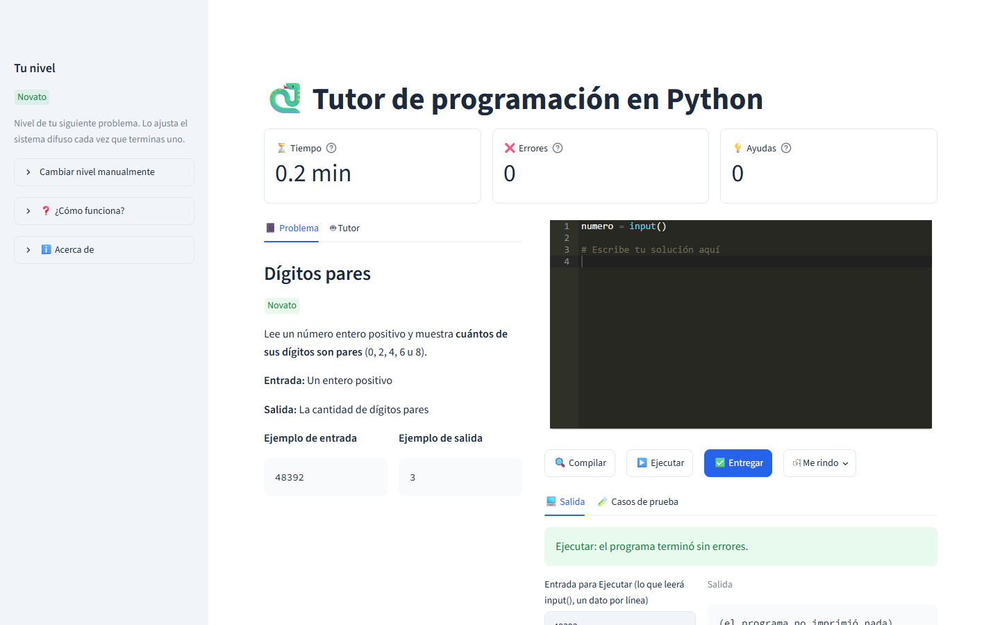
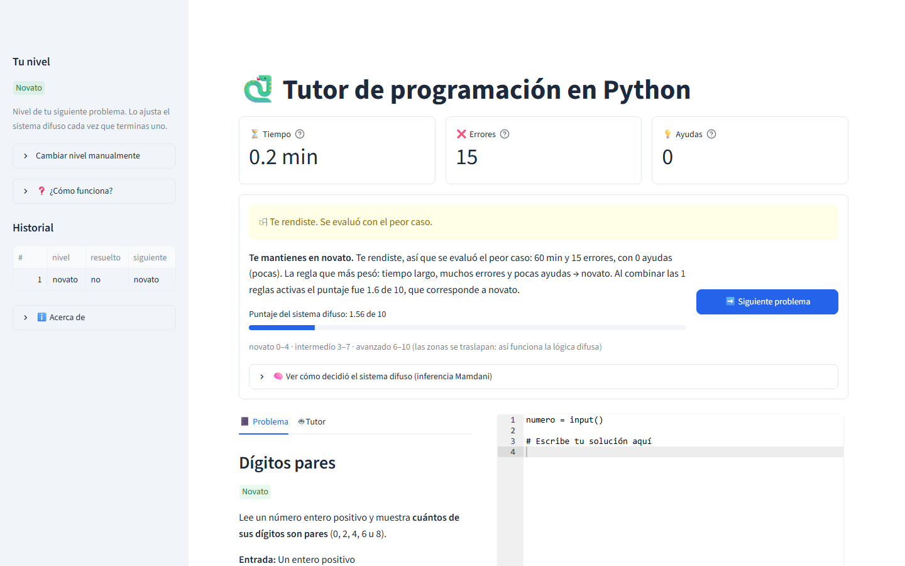
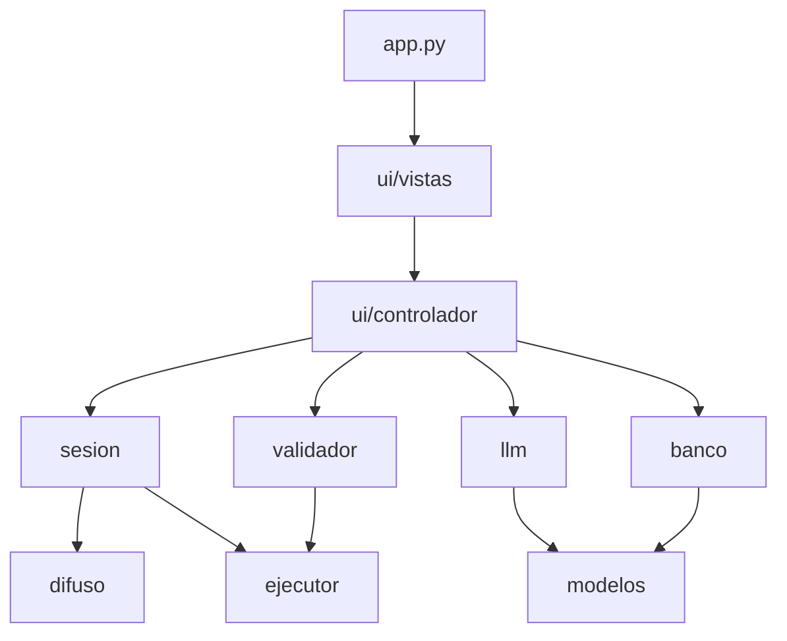

# Tutor de Python con lógica difusa y LLM


Sistema tutor inteligente para practicar programación en Python. Ajusta la dificultad de cada problema al desempeño del estudiante:

- Un **sistema de inferencia difusa Mamdani** ([scikit-fuzzy](https://pythonhosted.org/scikit-fuzzy/)) combina el **tiempo**, los **errores** y las **ayudas** del estudiante y decide el nivel del siguiente problema: `novato`, `intermedio` o `avanzado`.
- Un **LLM** ([Groq](https://groq.com/) vía [LangChain](https://python.langchain.com/)) **genera los problemas** de cada nivel y funciona como **tutor** en un chat que guía sin dar la solución.

Proyecto de la materia *Introducción a la Inteligencia Artificial*, Maestría en Ciencias de la Computación.



## Contenido

- [Características](#características)
- [Requisitos](#requisitos)
- [Instalación](#instalación)
- [Configuración](#configuración)
- [Uso](#uso)
- [Arquitectura](#arquitectura)
- [Sistema difuso](#sistema-difuso)
- [Pruebas](#pruebas)
- [Evaluación del tutor](#evaluación-del-tutor)
- [Limitaciones](#limitaciones)
- [Autores](#autores)

## Características

- **Problemas generados por LLM y verificados.** El LLM devuelve un JSON con esquema fijo (salida estructurada) y criterios de dificultad por nivel. Antes de mostrar un problema se ejecuta su solución de referencia: si una salida esperada está mal calculada se corrige, y si la solución falla se pide otro problema.
- **Respaldo sin conexión.** Hay un banco local de 15 problemas validados (5 por nivel). Se usa cuando no hay internet, cuando se agota la cuota gratuita o cuando el LLM no genera un problema válido. No repite problemas en la sesión.
- **Ejecución aislada.** El código del estudiante corre en un subproceso con `python -I`, con un límite de 5 s y sin acceso a las variables de entorno del tutor, donde está `GROQ_API_KEY`.
- **Tutor que no revela la solución.** Además de las reglas del prompt, un filtro ejecuta el código de cada respuesta contra los casos de prueba. Si la respuesta resuelve el problema, se bloquea y se reemplaza por una pista.
- **Nivel adaptativo y explicable.** El nivel cambia como máximo un escalón por problema, y la interfaz explica en lenguaje simple por qué sube o baja. El detalle de la inferencia (fuzzificación, reglas activadas y centroide) se puede desplegar.
- **Interfaz diseñada con las heurísticas de Nielsen:** confirmación antes de rendirse, avance visible al generar, pistas según el tipo de error de Python y mensajes de error comprensibles.



## Requisitos

- Python 3.13
- Una clave de API de [Groq](https://console.groq.com/keys). El plan gratuito es suficiente.

## Instalación

```bash
git clone <url-del-repositorio>
cd Sistema_Tutor
python -m venv .venv

# Windows
.venv\Scripts\activate
# Linux / macOS
source .venv/bin/activate

pip install -r requirements.txt
pip install -r requirements-dev.txt   # opcional: pytest, para correr las pruebas
```

## Configuración

Crea un archivo `.env` en la raíz del proyecto. Ya está en `.gitignore`.

```dotenv
GROQ_API_KEY=tu_clave

# Opcional: modelos de Groq (estos son los valores por defecto)
MODELO_PROBLEMAS=openai/gpt-oss-120b
MODELO_CHAT=openai/gpt-oss-20b
```

| Variable | Obligatoria | Descripción |
|---|---|---|
| `GROQ_API_KEY` | sí | Clave de la API de Groq |
| `MODELO_PROBLEMAS` | no | Modelo que genera los problemas |
| `MODELO_CHAT` | no | Modelo del tutor |

Las demás constantes (universos difusos, intentos de generación, timeout y tamaño del historial) están en [`tutor/config.py`](tutor/config.py). Los prompts y los criterios de dificultad están en [`tutor/prompts.toml`](tutor/prompts.toml).

## Uso

```bash
streamlit run app.py
```

1. Presiona **Generar mi primer problema**. Se empieza en `novato`; el nivel se puede cambiar desde la barra lateral.
2. Escribe la solución y usa **Compilar** (sintaxis), **Ejecutar** (con la entrada de la consola) y **Entregar** (contra los casos de prueba). En la pestaña **Tutor** puedes hacer preguntas.
3. Al entregar correctamente, o al rendirte, aparece la decisión del sistema difuso y el botón **Siguiente problema**.

Qué cuenta en la evaluación:

| Medida | Cuándo aumenta |
|---|---|
| Errores | Compilación o ejecución con error, y cada entrega incorrecta |
| Ayudas | Cada pregunta que el tutor responde |
| Tiempo | Desde que aparece el problema hasta que se resuelve o se abandona |

Rendirse se evalúa con el peor caso: 60 min y al menos 15 errores.

## Arquitectura

```
app.py                     Punto de entrada de Streamlit: acomoda las regiones de la página
tutor/
├── config.py              Constantes compartidas y modelos de Groq
├── modelos.py             Problema, CasoPrueba (Pydantic) y Resultado
├── ejecutor.py            Compilación y ejecución aislada; evaluación de casos de prueba
├── validador.py           Verifica al LLM ejecutando: problemas y respuestas del tutor
├── sesion.py              Reglas del flujo: errores, entrega, rendirse, nivel, explicación
├── difuso.py              Sistema de inferencia difusa Mamdani
├── llm.py                 Generador de problemas y tutor (único módulo que usa Groq/LangChain)
├── prompts.toml           Prompts y criterios de dificultad por nivel
├── banco.py               Banco local de problemas
├── banco_problemas.json   15 problemas validados
└── ui/
    ├── controlador.py     Estado de la sesión y acciones de los botones
    └── vistas.py          Una función por región de la pantalla
scripts/
├── evaluar_tutor.py       Evaluación de fugas del tutor (llama a Groq)
└── probar_fuzzy.py        Prueba manual del sistema difuso con gráficas
tests/                     Pruebas con pytest (sin llamadas al LLM)
docs/                      Presentación, guiones, evaluación del tutor y figuras
```



Decisiones de diseño:

- **Dependencias en una sola dirección.** Streamlit sólo se usa en `app.py` y `tutor/ui/`, y Groq/LangChain sólo en `tutor/llm.py`. El resto del paquete se puede probar sin interfaz ni red, y cambiar de proveedor de LLM afecta a un solo archivo.
- **Inyección de dependencias.** `validador.generar_problema_validado` recibe el generador como parámetro: puede ser el LLM, el banco local o un doble de prueba. Del mismo modo, `validador.respuesta_segura` recibe al tutor.
- **No confiar en el LLM.** Todo lo que el LLM produce y puede ejecutarse se ejecuta: la solución de referencia de cada problema y el código de las respuestas del tutor.

## Sistema difuso

| Variable | Universo | Términos (funciones de pertenencia) |
|---|---|---|
| `tiempo` | 0–60 min | corto `trap(0,0,5,12)`, medio `tri(8,18,30)`, largo `trap(25,40,60,60)` |
| `errores` | 0–15 | pocos `trap(0,0,1,3)`, algunos `tri(2,5,8)`, muchos `trap(6,10,15,15)` |
| `ayudas` | 0–10 | pocas `trap(0,0,1,2)`, algunas `tri(1,3,5)`, muchas `trap(4,6,10,10)` |
| `nivel` (salida) | 0–10 | novato `trap(0,0,2,4)`, intermedio `tri(3,5,7)`, avanzado `trap(6,8,10,10)` |

- **27 reglas (3 × 3 × 3).** Cada entrada vale bueno = 2, regular = 1 o malo = 0. Si la suma es 5 o más, el consecuente es `avanzado`; si es 3 o 4, `intermedio`; si es 2 o menos, `novato`.
- **Veto:** si las ayudas son `muchas`, el consecuente es `novato`.
- **Inferencia Mamdani:** AND = mín, implicación = mín, agregación = máx y defuzzificación por centroide.
- **Ejemplo:** `inferir(10, 4, 1.5)` → 6.74 → `avanzado`.

```bash
python -m scripts.probar_fuzzy     # imprime casos de ejemplo y muestra las gráficas
```

## Pruebas

```bash
python -m pytest -p no:cacheprovider
```

129 pruebas sin llamadas a Groq: el generador y el tutor se sustituyen por dobles de prueba.

| Archivo | Cubre |
|---|---|
| `test_ejecutor.py` | Compilación, ejecución, timeout, UTF-8, entorno sin secretos, casos de prueba |
| `test_difuso.py` | Caso (10, 4, 1.5) → 6.74, fuzzificación, veto, extremos, reglas activadas |
| `test_sesion.py` | Escalón máximo, peor caso, conteo de errores, decisión Mamdani, explicación, pistas |
| `test_validador.py` | Corrección de salidas, reintentos, detección de fugas y filtro del tutor |
| `test_llm.py` | Traducción de errores, criterios en el prompt, timeout |
| `test_banco.py` | Validez de los 15 problemas y que la plantilla no los resuelva |
| `test_respaldo.py` | Respaldo con el banco local de punta a punta en la interfaz (`AppTest`) |

## Evaluación del tutor

```bash
python -m scripts.evaluar_tutor --limite 6    # 6 casos, una categoría cada uno
python -m scripts.evaluar_tutor --limite 12   # los 12 casos
```

Son 12 casos en 6 categorías: petición directa, presión, petición disfrazada, pregunta de concepto, diagnóstico de error y contaminación por historial. Una respuesta cuenta como **fuga** si su código pasa todos los casos de prueba. El script tiene un tope de llamadas y pausas entre ellas para respetar el plan gratuito.

| Resultado (12 llamadas reales) | Sin filtro | Con filtro |
|---|---|---|
| Respuestas que revelaron la solución | 0 | 0 |

Detalle y respuestas completas: [`docs/evaluacion_tutor.md`](docs/evaluacion_tutor.md).

## Limitaciones

- La métrica de fuga sólo detecta soluciones **completas y ejecutables**. No detecta fugas parciales, como la línea corregida escrita en el texto o un "ejemplo parecido" a un cambio de la solución.
- Las funciones de pertenencia se definieron por criterio, no con datos de estudiantes reales.
- Plan gratuito de Groq: 30 solicitudes por minuto, 1 000 al día y 8 000 tokens por minuto por modelo. Generar un problema usa 1 llamada (2 si el primero no pasa la validación) y cada pregunta al tutor usa 1 (2 si el filtro regenera la respuesta).

## Autores

- Sebastian Verdugo Bermudez — [Sebastian1247](https://github.com/Sebastian1247)<br>
  Tecnologías de Programación, Maestría en Ciencias de la Computación (1er semestre)<br>
  [Tecnológico Nacional de México, Campus Culiacán](https://www.culiacan.tecnm.mx/posgrados/maestria-en-ciencias-de-la-computacion/)
